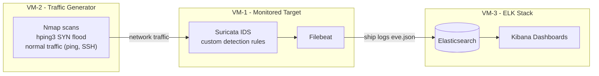

# Network Intrusion Detection with Suricata and the ELK Stack

A hands-on lab building a network intrusion detection system (IDS) and visualizing alerts end to end.

## Overview
I built a three-VM intrusion detection environment to monitor network traffic, detect simulated attacks, and visualize alerts in a central dashboard. The goal was to confirm a full detection-and-visualization pipeline works from end to end.

## Architecture
- **VM-1** - monitored target running Suricata
- **VM-2** - traffic generator (normal and malicious)
- **VM-3** - ELK stack (Elasticsearch + Kibana)
- **Pipeline:** Suricata detects → Filebeat ships logs → Elasticsearch indexes → Kibana visualizes

## What I did
- Deployed and configured **Suricata** as the IDS engine on Ubuntu VMs
- Wrote **custom detection rules** for reconnaissance and denial-of-service patterns (Nmap SYN scans, ICMP host discovery, and high- and moderate-rate SYN floods)
- Established a baseline of normal traffic (ping, SSH) to distinguish legitimate activity from attacks
- Simulated attacks with **Nmap** and **hping3**, and confirmed each custom rule fired correctly
- Configured **Filebeat** to forward structured logs to **Elasticsearch**, and validated ingestion and visualization in **Kibana**

## Tools & Technologies
Suricata, ELK Stack (Elasticsearch, Kibana, Filebeat), Nmap, hping3, Ubuntu Linux, VMware

## Skills demonstrated
Detection rule writing, network traffic analysis, SIEM log pipelines, alert triage, Linux administration, methodical testing and documentation

## Note
This repository is a summary of a lab exercise for learning purposes. It contains no live attack tooling or sensitive data.
